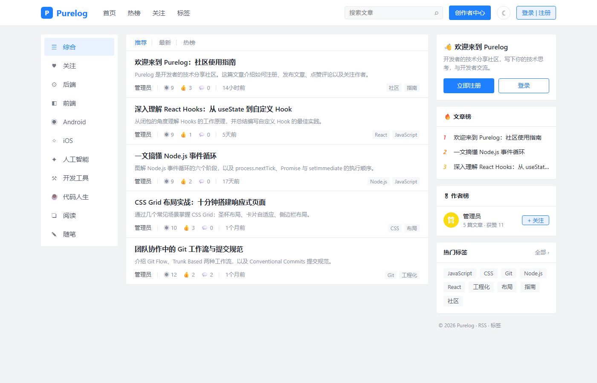
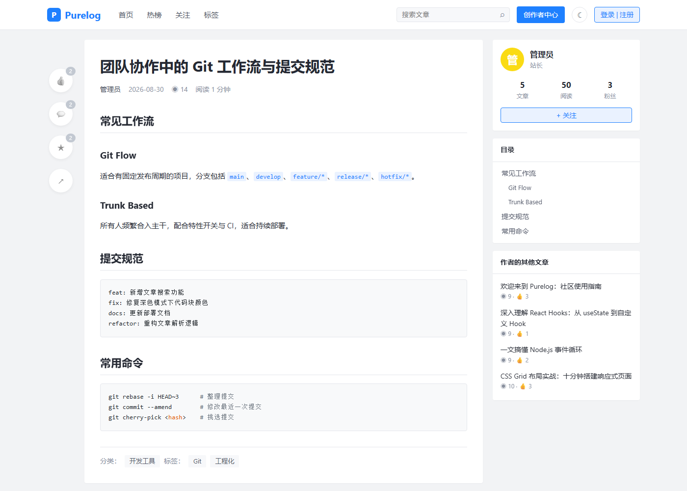
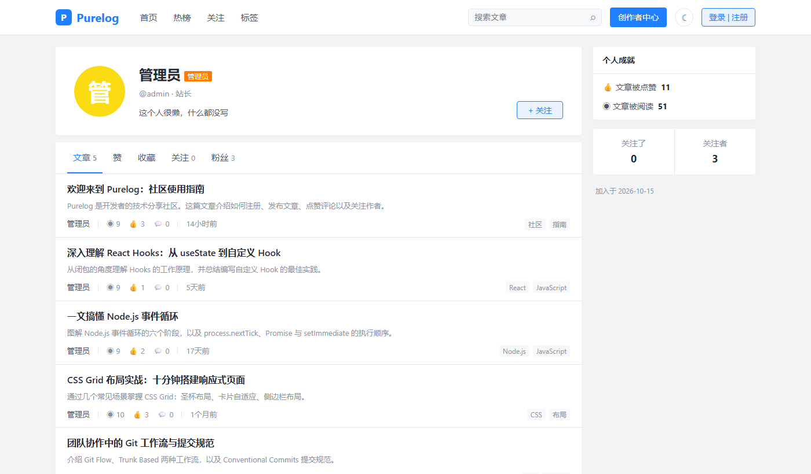

<div align="center">

# Purelog

**一个纯粹的技术记录与分享平台：只关心技术与成长，没有广告，没有干扰。**

[在线体验](https://purelog-web.vercel.app/) · [功能特性](#功能特性) · [本地运行](#本地运行) · [部署](#部署到-vercel)


</div>

---

## 为什么是 Purelog

很多技术社区越来越"吵"：开屏广告、弹窗、关注后才能阅读全文、强制下载 App、推荐流里夹杂着营销内容……

Purelog 想回到写技术博客最初的样子：

- **专注技术学习**：频道只围绕技术方向（后端、前端、移动端、人工智能、开发工具……），内容就是文章本身
- **简洁无广告**：没有广告位、没有弹窗、没有付费墙、不强制登录才能阅读
- **纯粹**：干净的阅读排版、代码高亮、自动目录，打开就能读
- **开放交流**：任何人都可以注册写作，用点赞、评论、收藏、关注和其他开发者交流

## 在线体验

**👉 [https://purelog-web.vercel.app/](https://purelog-web.vercel.app/)**

无需注册即可浏览所有文章，注册后即可发布文章、参与讨论。

## 页面展示

### 首页

频道导航 + 文章流 + 文章榜 / 作者榜 / 热门标签，支持「推荐 · 最新 · 热榜」三种排序。



### 文章详情

沉浸式阅读：左侧点赞 / 评论 / 收藏 / 分享，右侧作者卡片与自动生成的目录，代码块支持高亮和一键复制。



### 个人主页

展示作者的文章、点赞、收藏、关注与粉丝，以及获赞和阅读数据。



## 功能特性

| 模块 | 说明 |
| --- | --- |
| ✍️ 写作 | Markdown 编辑器，实时预览，本地自动保存草稿，支持分类、标签、封面与摘要 |
| 📖 阅读 | 代码高亮与一键复制、自动目录、阅读进度条、阅读时长估算、相关推荐 |
| 💬 互动 | 文章点赞 / 收藏，评论与楼中楼回复，评论点赞，关注作者 |
| 🧭 发现 | 技术频道、标签广场、站内全文搜索、「关注」动态流、文章榜与作者榜 |
| 👤 个人 | 个人主页、资料与头像设置、修改密码 |
| 🛡️ 管理 | 管理后台：站点统计、管理全站文章、禁言违规用户 |
| 🌗 体验 | 深色模式、移动端适配、RSS 订阅、SEO（Sitemap / Open Graph / JSON-LD） |

**安全**：密码使用 scrypt 加盐哈希；会话使用 HMAC 签名的 httpOnly Cookie；用户内容经过 XSS 过滤；发文与评论有频率限制；可选注册邀请码。

## 技术栈

- **框架**：[Next.js](https://nextjs.org/) 16（App Router、Server Components、Server Actions）+ React 19 + TypeScript
- **数据库**：PostgreSQL（线上使用 [Neon](https://neon.tech/)，本地开发自动使用嵌入式 [PGlite](https://pglite.dev/)，零配置）
- **Markdown**：marked + highlight.js + sanitize-html
- **部署**：Vercel

## 本地运行

需要 Node.js 20+。

```bash
git clone https://github.com/11zhangzheng/Purelog.git
cd Purelog
npm install
npm run dev
```

打开 http://localhost:3000 即可。

- 本地**无需安装数据库**：未配置 `DATABASE_URL` 时自动使用嵌入式数据库（数据保存在 `.data/`，删除该目录即可重置）
- 首次启动会自动建表，并写入几篇示例文章
- 本地默认管理员账号：`admin` / `123456`（仅限本地开发；线上不会使用默认密码）

## 部署到 Vercel

1. Fork 本仓库，在 [Vercel](https://vercel.com/new) 中导入
2. 在项目的 **Storage** 页创建一个 Postgres（Neon）数据库并连接到项目，`DATABASE_URL` 会自动注入
3. 在 **Settings → Environment Variables** 中添加：

   | 变量 | 必填 | 说明 |
   | --- | :---: | --- |
   | `AUTH_SECRET` | ✅ | 会话签名密钥，可用 `openssl rand -base64 32` 生成 |
   | `ADMIN_PASSWORD` | ✅ | 管理员密码（请使用强密码） |
   | `ADMIN_USERNAME` | | 管理员用户名，默认 `admin` |
   | `NEXT_PUBLIC_SITE_URL` | | 站点域名，用于 RSS / Sitemap，默认使用 Vercel 生产域名 |
   | `REGISTER_INVITE_CODE` | | 设置后注册需要填写邀请码 |
   | `DISABLE_SEED` | | 设为 `1` 则不写入示例文章 |

4. 点击 Deploy。数据表会在首次访问时自动创建，无需手动迁移

站点名称、简介和频道列表可以在 [`lib/site.ts`](lib/site.ts) 中修改。

## 项目结构

```
app/
├── page.tsx              # 首页文章流
├── c/[key]/              # 技术频道
├── tag/[tag]/  tags/     # 标签页与标签广场
├── posts/[slug]/         # 文章详情
├── write/                # 写文章 / 编辑文章
├── user/[username]/      # 个人主页
├── following/            # 关注动态
├── search/               # 搜索
├── settings/             # 账号设置
├── admin/                # 管理后台
├── login/                # 登录注册
└── actions.ts            # Server Actions（发文、点赞、评论、关注……）
components/               # UI 组件
lib/
├── db.ts                 # 数据库连接与自动建表
├── auth.ts               # 会话与权限
├── posts.ts              # 文章、评论、用户查询
├── markdown.ts           # Markdown 渲染与过滤
└── site.ts               # 站点配置与频道
```

## 参与贡献

欢迎提交 Issue 和 Pull Request。如果这个项目对你有帮助，欢迎点个 ⭐ Star。

